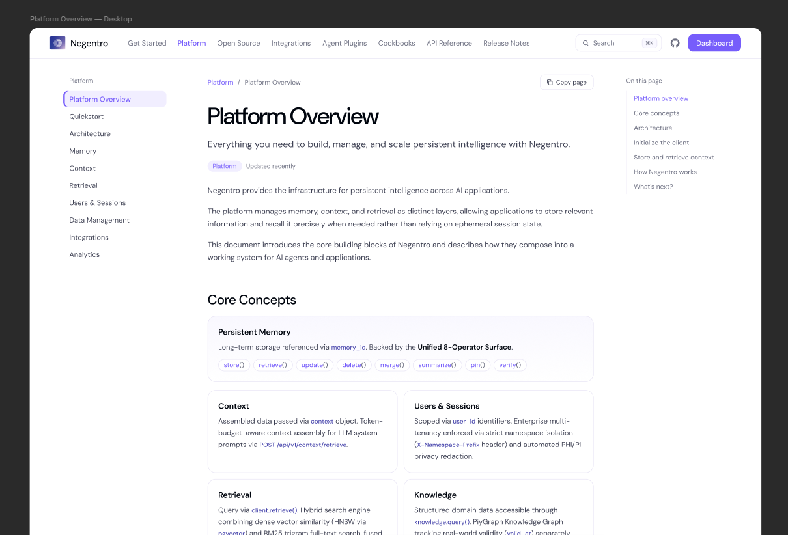

# PiyAPI - API Reference Overview Documentation

## 1. Top Configuration

* **Breadcrumb:** `API Reference / Overview`
* **Action:** `[Copy page]`

## 2. Left Sidebar Navigation

* **API REFERENCE**
  * Overview
* **ORGANIZATIONS & PROJECTS**
  * Organizations
  * Projects
* **CORE MEMORY OPERATIONS**
  * Add Memories `POST`
  * Get Memories `GET`
  * Search Memories `POST`
  * Update Memory `PATCH`
  * Delete Memory `DEL`
* **MEMORY MANAGEMENT**
  * Create Memory Export
  * Feedback
  * Get Memory
  * Memory History
  * Get Memory Export
  * Submit Update Memories
  * Batch Delete Memories
  * Delete Memories
* **EVENTS**
  * Get Events `GET`

## 3. Right Sidebar Navigation ("On this page")

* API Reference Overview
* Quick Start Guide
* Core Operations
* API Categories
* Authentication
* Next Steps

---

# API Reference Overview

REST APIs for memory management, search, entity operations, and persistent context.

The PiyAPI REST API provides programmatic access to persistent memory and context operations, allowing applications and agents to create, retrieve, search, update, and manage memory through standard HTTP requests.

**API VERSION**: `v1`
**BASE URL**: `Configure in your deployment`

> **Quick start**
> Get your API key and make your first memory request in a few minutes.
> `[Get API key →]`

## Quick Start Guide

**01 Add Memories**
Store information and context from your application's conversations or events. `[See Add Memories →]`

**02 Search Memories**
Retrieve relevant memories using semantic or contextual search. `[See Search Memories →]`

**03 Get Memories**
Retrieve a specific stored memory when you already know its identifier. `[See Get Memories →]`

```bash
curl -X POST "https://<your-piyapi-endpoint>/v1/memories" \
  -H "Authorization: Bearer $PIYAPI_API_KEY" \
  -H "Content-Type: application/json" \
  -d '{"user_id": "user_123", "content": "User prefers concise explanations"}'
```

## Core Operations

| METHOD           | ENDPOINT                | DESCRIPTION                                                                               |
| :--------------- | :---------------------- | :---------------------------------------------------------------------------------------- |
| **POST**   | `/v1/memories`        | **Add Memories**Store new memories from conversations and interactions.             |
| **POST**   | `/v1/memories/search` | **Search Memories**Find relevant memories using semantic search and filters.        |
| **PATCH**  | `/v1/memories/:id`    | **Update Memory**Modify existing memory content or metadata.                        |
| **DELETE** | `/v1/memories/:id`    | **Delete Memory**Remove a specific memory or perform supported deletion operations. |

## API Categories

Explore the API by functionality.

* **Memory APIs**: Core memory operations including create, search, update, delete, history, and export workflows.
* **Events APIs**: Track and inspect asynchronous memory-related events.
* **Entities APIs**: Manage users, agents, applications, and associated memory data.
* **Organizations & Projects**: Manage organization-level access, projects, and collaboration boundaries.
* **Webhooks**: Receive real-time notifications for supported memory and system events.

> **Building a multi-tenant application?**
> Learn how Organizations & Projects can be used to separate access, resources, and collaboration boundaries.
> `[Organizations & Projects →]`

## Authentication

All requests to the PiyAPI API must include a valid API key passed via the `Authorization` header using the Bearer scheme. Requests without a valid key will be rejected.

```text
Header
Authorization: Bearer <PIYAPI_API_KEY>
```

* API keys should be stored server-side.
* Requests should be made through secure server-side environments.
* Do not expose secrets in client-side code.

```javascript
const response = await fetch(
  "https://<your-piyapi-endpoint>/v1/memories",
  { headers: { Authorization: `Bearer ${process.env.PIYAPI_API_KEY}` } }
)
```

*(Diagram: `Your Application` --[HTTP Request]--> `PiyAPI API (Memory / Context Layer)` --[JSON Response]--> `Response`)*

> [!WARNING]
> Keep your API key secure. Never expose API credentials in client-side code or public repositories. Use environment variables and server-side requests.

## Next Steps

* **Add your first memory**: Start storing persistent context through the API. `→`
* **Search with filters**: Learn advanced search and filtering techniques. `→`
* **Build with cookbooks**: See complete API workflows inside practical projects. `→`

---

**Footer Actions:** `[Suggest edits]` | `[Raise issue]`

**Footer Navigation:** `← PREVIOUS: Cookbooks` | `NEXT: Organizations & Projects →`

---

> **Editor's Note: Navbar Adjustments**
>
> * **Right Sidebar ("On this page")**: The first link in the Figma design originally read `Negentro REST API`. This was changed to `API Reference Overview` to match the exact `H1` title of the page and to adhere to the global replacement of the "Negentro" placeholder with the accurate "PiyAPI" product name, ensuring the technical flow remains consistent.
> * **Left Sidebar (API Endpoints)**: The `DEL` badge next to `Delete Memory` was preserved exactly as designed in Figma, though technically it represents a `DELETE` HTTP method.
